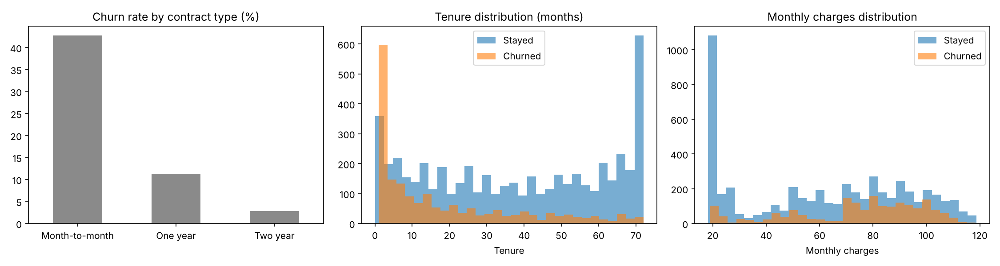
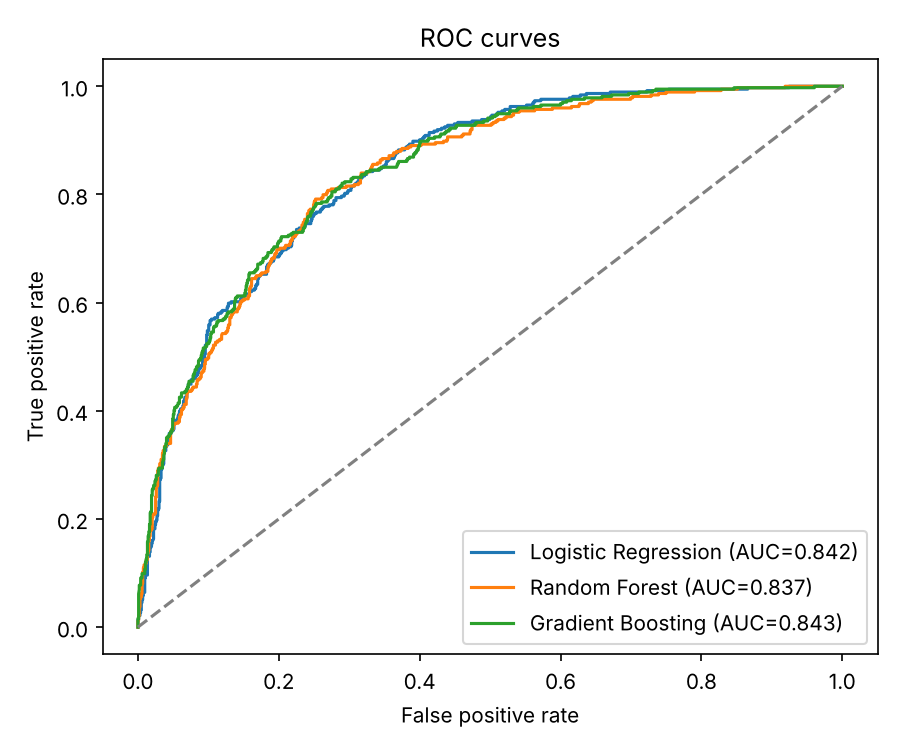
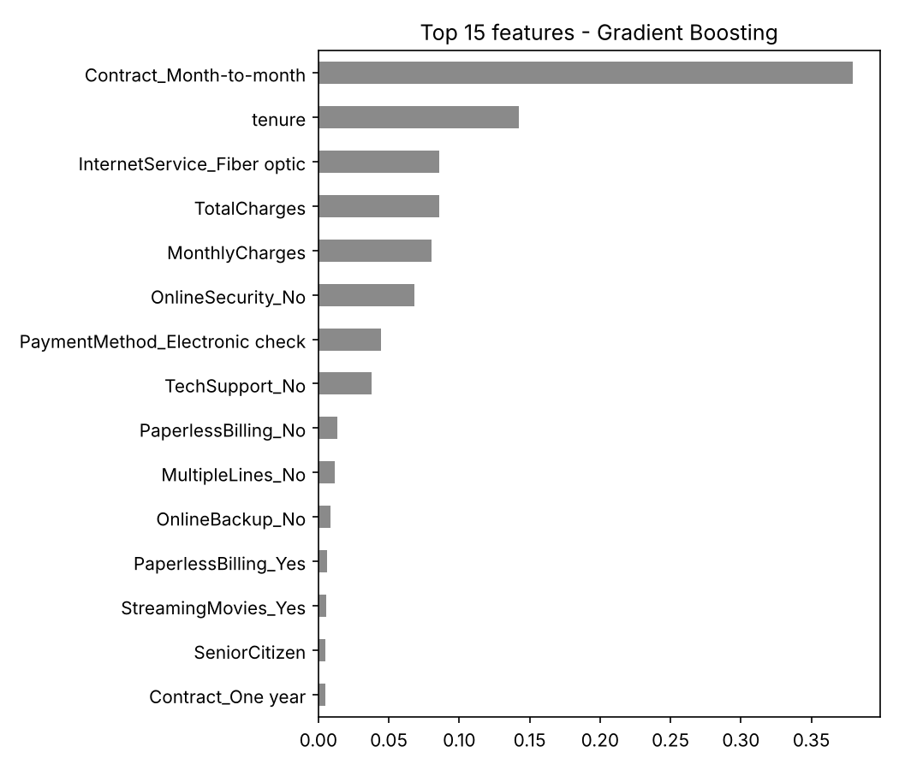

# Telecom Customer Churn Prediction

A machine learning project that predicts which telecom customers are likely to leave (churn), built with clean, modular, object-oriented Python and scikit-learn.

Retaining an existing customer is usually cheaper than acquiring a new one, so identifying at-risk customers early lets an operator target them with retention offers.

## Dataset

[IBM Telco Customer Churn](https://github.com/IBM/telco-customer-churn-on-icp4d) dataset: 7,043 customers, 20 features (account info, services, contract, billing) and a `Churn` label. About 26.5% of customers churned.

## Key findings (EDA)

- **Contract type is the strongest signal:** month-to-month customers churn at about 42.7%, one-year at 11.3%, two-year at only 2.8%.
- **Fiber optic customers churn more** (about 41.9%) than DSL (19.0%) or customers without internet (7.4%).
- **New customers are the most at risk:** churn is concentrated in the first months of tenure.



## Models and results

Three models were trained on an 80/20 stratified split and compared on the held-out test set:

| Model | Accuracy | Precision | Recall | F1 | ROC-AUC |
|---|---|---|---|---|---|
| Logistic Regression | 0.738 | 0.504 | 0.783 | 0.614 | 0.842 |
| Random Forest | 0.761 | 0.536 | 0.743 | 0.623 | 0.837 |
| Gradient Boosting | 0.803 | 0.666 | 0.516 | 0.581 | 0.843 |

Notes:

- ROC-AUC is nearly identical across models, so the choice depends on the business goal.
- Logistic Regression and Random Forest use balanced class weights and catch more churners (higher recall). Gradient Boosting is more precise but misses more churners.
- For a retention campaign, high recall is usually preferred, since missing a churner costs more than contacting a loyal customer.




## Project structure

```
telecom-churn-prediction/
├── data/                       # Raw dataset
├── src/churn/
│   ├── config.py               # Paths and constants
│   ├── data_loader.py          # DataLoader class (loading, validation, cleaning)
│   ├── preprocessing.py        # Preprocessor class (split, scaling, encoding)
│   ├── models.py               # Abstract base model + 3 concrete models
│   ├── evaluation.py           # Metrics and plots
│   ├── exceptions.py           # Custom exceptions (error handling)
│   └── utils.py                # Timer decorator
├── tests/                      # pytest unit tests
├── reports/                    # Results table and figures
└── main.py                     # Runs the full pipeline
```

## How to run

```bash
git clone https://github.com/<your-username>/telecom-churn-prediction.git
cd telecom-churn-prediction
python -m venv .venv
source .venv/bin/activate        # Windows: .venv\Scripts\activate
pip install -r requirements.txt
python main.py
pytest
```

`main.py` loads the data, trains all models, prints the comparison table, saves figures to `reports/figures/`, and stores the best model in `models/`.

## Tech stack

Python, pandas, NumPy, scikit-learn, matplotlib, pytest

## Possible improvements

- Hyperparameter tuning with cross-validation
- Decision threshold tuning to balance precision and recall
- SHAP-based explanations for individual predictions
- A small web app (Streamlit) to score a customer interactively
